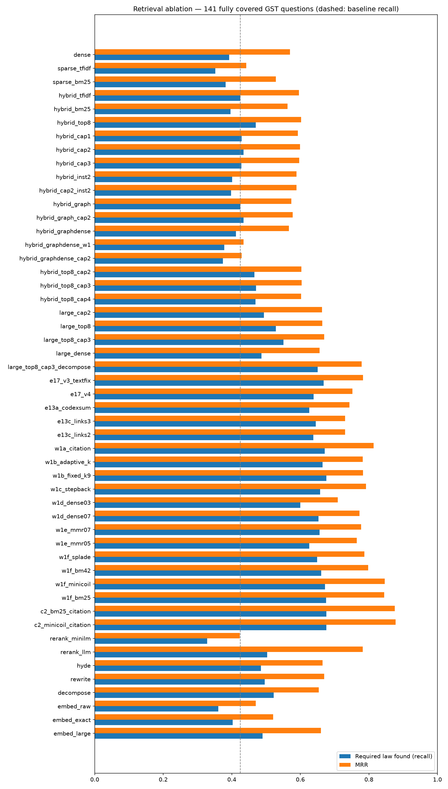
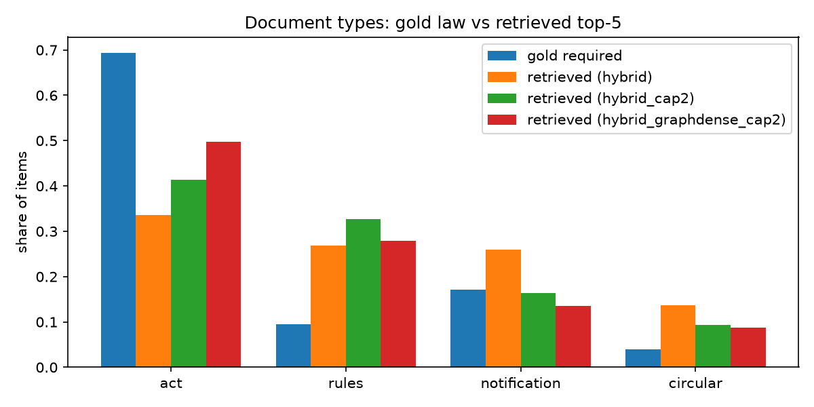

# Thesis results (generated by scripts/thesis/make_report.py)

Retrieval: 141 fully covered questions, corrected gold sources, top-5 unless stated. Baseline: **hybrid_tfidf** (the system default). Δ = paired difference in required-law recall vs the baseline, 95% bootstrap CI; p = Wilcoxon signed-rank (* < 0.05).

## RQ3 — retrieval method

| Config | Description | Required law found | All required found | hit@k | MRR | Δ recall vs baseline [95% CI] | p |
|---|---|---|---|---|---|---|---|
| dense | Dense only (text-embedding-3-small) | 0.392 | 0.227 | 0.716 | 0.570 | -0.033 [-0.069, +0.000] | 0.075 |
| sparse_tfidf | Sparse only, TF-IDF | 0.352 | 0.191 | 0.667 | 0.442 | -0.073 [-0.120, -0.028] | 0.045 * |
| sparse_bm25 | Sparse only, BM25 | 0.382 | 0.206 | 0.738 | 0.529 | -0.043 [-0.098, +0.010] | 0.142 |
| **hybrid_tfidf** | Hybrid dense + TF-IDF (RRF) — system default | 0.425 | 0.248 | 0.766 | 0.596 | — | — |
| hybrid_bm25 | Hybrid dense + BM25 (RRF) | 0.396 | 0.220 | 0.723 | 0.563 | -0.029 [-0.075, +0.014] | 0.078 |
| hybrid_top8 | Hybrid TF-IDF, top_k = 8 | 0.470 | 0.270 | 0.809 | 0.602 | +0.044 [+0.024, +0.069] | 0.003 * |

## RQ2 — what text is embedded, and the embedding model

| Config | Description | Required law found | All required found | hit@k | MRR | Δ recall vs baseline [95% CI] | p |
|---|---|---|---|---|---|---|---|
| embed_raw | Embed raw provision text only (hybrid) | 0.361 | 0.199 | 0.688 | 0.470 | -0.064 [-0.104, -0.027] | 0.001 * |
| embed_exact | Embed hierarchy prefix + text, no LLM metadata (hybrid) | 0.403 | 0.234 | 0.745 | 0.521 | -0.022 [-0.055, +0.009] | 0.114 |
| **hybrid_tfidf** | Hybrid dense + TF-IDF (RRF) — system default | 0.425 | 0.248 | 0.766 | 0.596 | — | — |
| embed_large | Enriched text, text-embedding-3-large (hybrid) | 0.490 | 0.291 | 0.823 | 0.660 | +0.065 [+0.034, +0.099] | 0.001 * |

## RQ1 — document structure: doc-type balance, diversity and graph expansion

| Config | Description | Required law found | All required found | hit@k | MRR | Δ recall vs baseline [95% CI] | p |
|---|---|---|---|---|---|---|---|
| **hybrid_tfidf** | Hybrid dense + TF-IDF (RRF) — system default | 0.425 | 0.248 | 0.766 | 0.596 | — | — |
| hybrid_cap1 | Hybrid, max 1 notification/circular in top 5 | 0.429 | 0.255 | 0.773 | 0.593 | +0.004 [-0.013, +0.024] | 0.777 |
| hybrid_cap2 | Hybrid, max 2 notifications/circulars in top 5 | 0.434 | 0.255 | 0.780 | 0.599 | +0.009 [-0.005, +0.027] | 0.750 |
| hybrid_cap3 | Hybrid, max 3 notifications/circulars in top 5 | 0.428 | 0.248 | 0.773 | 0.597 | +0.003 [-0.002, +0.010] | 0.745 |
| hybrid_inst2 | Hybrid, max 2 items per instrument (diversity) | 0.401 | 0.220 | 0.738 | 0.589 | -0.024 [-0.053, -0.000] | 0.625 |
| hybrid_cap2_inst2 | Hybrid, cap 2 notifications/circulars + max 2 per instrument | 0.398 | 0.220 | 0.738 | 0.589 | -0.027 [-0.057, -0.002] | 0.432 |
| hybrid_graph | Hybrid + graph expansion (cross-reference neighbours) | 0.425 | 0.248 | 0.766 | 0.574 | +0.000 [+0.000, +0.000] | — |
| hybrid_graph_cap2 | Hybrid + graph expansion + cap 2 | 0.434 | 0.255 | 0.780 | 0.578 | +0.009 [-0.005, +0.027] | 0.750 |
| hybrid_graphdense | Hybrid + graph neighbours ranked by query similarity (w 0.5) | 0.412 | 0.234 | 0.738 | 0.567 | -0.014 [-0.031, -0.002] | 0.334 |
| hybrid_graphdense_w1 | Hybrid + graph neighbours ranked by query similarity (w 1.0) | 0.378 | 0.213 | 0.709 | 0.434 | -0.047 [-0.080, -0.017] | 0.023 * |
| hybrid_graphdense_cap2 | Hybrid + similarity-ranked graph neighbours (w 1.0) + cap 2 | 0.374 | 0.206 | 0.688 | 0.429 | -0.051 [-0.085, -0.020] | 0.023 * |

## RQ3 — reranking

| Config | Description | Required law found | All required found | hit@k | MRR | Δ recall vs baseline [95% CI] | p |
|---|---|---|---|---|---|---|---|
| **hybrid_tfidf** | Hybrid dense + TF-IDF (RRF) — system default | 0.425 | 0.248 | 0.766 | 0.596 | — | — |
| rerank_minilm | Hybrid + MiniLM-L6 cross-encoder (512 tokens) | 0.328 | 0.170 | 0.645 | 0.423 | -0.097 [-0.148, -0.050] | 0.001 * |
| rerank_llm | Hybrid + LLM listwise rerank (Gemini flash-lite) | 0.503 | 0.291 | 0.851 | 0.782 | +0.078 [+0.047, +0.113] | 0.000 * |
| hybrid_pool20 | Hybrid top 20 (upper bound for any reranker over the pool) | 0.551 | 0.326 | 0.879 | 0.607 | +0.126 [+0.091, +0.165] | 0.000 * |

## RQ3 — query understanding (LLM)

| Config | Description | Required law found | All required found | hit@k | MRR | Δ recall vs baseline [95% CI] | p |
|---|---|---|---|---|---|---|---|
| **hybrid_tfidf** | Hybrid dense + TF-IDF (RRF) — system default | 0.425 | 0.248 | 0.766 | 0.596 | — | — |
| hyde | HyDE (3 hypothetical answers, dense) | 0.485 | 0.291 | 0.837 | 0.665 | +0.060 [+0.015, +0.107] | 0.064 |
| rewrite | LLM rewrites question into a legal-issue query (hybrid) | 0.496 | 0.298 | 0.858 | 0.670 | +0.070 [+0.012, +0.129] | 0.024 * |
| decompose | LLM decomposes into sub-queries + original, RRF (hybrid) | 0.522 | 0.319 | 0.865 | 0.654 | +0.096 [+0.052, +0.143] | 0.002 * |

## Final combination (E17)

| Config | Description | Required law found | All required found | hit@k | MRR | Δ recall vs baseline [95% CI] | p |
|---|---|---|---|---|---|---|---|
| **hybrid_tfidf** | Hybrid dense + TF-IDF (RRF) — system default | 0.425 | 0.248 | 0.766 | 0.596 | — | — |
| decompose | LLM decomposes into sub-queries + original, RRF (hybrid) | 0.522 | 0.319 | 0.865 | 0.654 | +0.096 [+0.052, +0.143] | 0.002 * |
| large_top8_cap3 | 3-large, hybrid, top_k 8, max 3 notifications/circulars | 0.551 | 0.340 | 0.894 | 0.670 | +0.126 [+0.085, +0.170] | 0.000 * |
| large_top8_cap3_decompose | Best stack (3-large, top_k 8, cap 3) + LLM decomposition, RRF | 0.651 | 0.404 | 0.979 | 0.779 | +0.226 [+0.173, +0.281] | 0.000 * |

## Document-type share of gold law vs retrieved items

| | act | rules | notification | circular |
|---|---|---|---|---|
| **gold required law** | 0.69 | 0.10 | 0.17 | 0.04 |
| retrieved: hybrid_tfidf | 0.34 | 0.27 | 0.26 | 0.14 |
| retrieved: dense | 0.28 | 0.32 | 0.24 | 0.16 |
| retrieved: hybrid_cap2 | 0.41 | 0.33 | 0.16 | 0.09 |
| retrieved: hybrid_graphdense_cap2 | 0.50 | 0.28 | 0.14 | 0.09 |

## Required-law recall by question difficulty

Tiers are set from the question and its gold law only (number of required provisions, instruments spanned, notification/circular needed, scenario length), before any system is run.

| Config | easy (n=36) | medium (n=35) | hard (n=35) | very_hard (n=35) |
|---|---|---|---|---|
| dense | 0.611 | 0.498 | 0.242 | 0.212 |
| sparse_bm25 | 0.583 | 0.467 | 0.312 | 0.160 |
| hybrid_tfidf | 0.694 | 0.490 | 0.261 | 0.247 |
| hybrid_top8 | 0.722 | 0.526 | 0.323 | 0.300 |
| embed_large | 0.792 | 0.538 | 0.334 | 0.288 |
| hyde | 0.750 | 0.595 | 0.334 | 0.254 |
| rerank_llm | 0.792 | 0.576 | 0.344 | 0.292 |
| rewrite | 0.722 | 0.657 | 0.331 | 0.266 |
| decompose | 0.819 | 0.636 | 0.363 | 0.260 |
| large_top8_cap3 | 0.903 | 0.605 | 0.349 | 0.337 |
| large_top8_cap3_decompose | 0.958 | 0.752 | 0.524 | 0.362 |

## Error analysis — why the baseline misses gold law

362 (question, gold source) pairs missed by the baseline top-5. Categories are checked in order.

| Category | Missed pairs | Share |
|---|---|---|
| in top-20 pool, ranked 6–20 (ranking problem) | 65 | 18% |
| not in pool, but a graph neighbour of the top-5 | 115 | 32% |
| not in pool or graph; top-5 dominated by notifications/circulars (crowding) | 68 | 19% |
| not found by any signal (vocabulary / query problem) | 114 | 31% |

Missed gold sources by document type: act 278 (77%), notification 49 (14%), rules 27 (7%), circular 8 (2%)

## Answer quality (RAGAS) and citation correctness

RAGAS judge: **qwen/qwen3-30b-a3b-instruct-2507**

| Run | n | Faithfulness | Answer relevancy | Abstained | Grounded citation precision | Answers citing law outside context | Gold law cited |
|---|---|---|---|---|---|---|---|
| hybrid (baseline) | 141 | 0.577 | 0.538 | 30 | 0.789 | 39 | 0.401 |
| hybrid + MiniLM rerank + CRAG | 141 | 0.614 | 0.504 | 41 | 0.797 | 36 | 0.378 |
| best stack (3-large, top-8, cap 3) | 141 | 0.565 | 0.643 | 11 | 0.845 | 39 | 0.473 |
| best stack + grounded prompt | 138 | 0.568 | 0.608 | 23 | 0.879 | 35 | 0.514 |

Paired tests vs **hybrid (baseline)** (questions answered in both runs):

| Comparison | Metric | n | A | B | B − A [95% CI] | Wilcoxon p | B better / A better |
|---|---|---|---|---|---|---|---|
| hybrid + MiniLM rerank + CRAG vs hybrid (baseline) | faithfulness | 140 | 0.577 | 0.612 | +0.034 [-0.019, +0.086] | 0.334 | 63/59 |
| hybrid + MiniLM rerank + CRAG vs hybrid (baseline) | answer_relevancy | 141 | 0.538 | 0.504 | -0.034 [-0.078, +0.009] | 0.230 | 55/66 |
| hybrid + MiniLM rerank + CRAG vs hybrid (baseline) | grounded_precision | 130 | 0.792 | 0.807 | +0.014 [-0.044, +0.074] | 0.896 | 27/30 |
| hybrid + MiniLM rerank + CRAG vs hybrid (baseline) | gold_citation_recall | 141 | 0.401 | 0.378 | -0.023 [-0.077, +0.031] | 0.411 | 22/29 |
| best stack (3-large, top-8, cap 3) vs hybrid (baseline) | faithfulness | 139 | 0.579 | 0.565 | -0.014 [-0.066, +0.038] | 0.756 | 59/59 |
| best stack (3-large, top-8, cap 3) vs hybrid (baseline) | answer_relevancy | 141 | 0.538 | 0.643 | +0.106 [+0.065, +0.148] | <0.001 * | 83/48 |
| best stack (3-large, top-8, cap 3) vs hybrid (baseline) | grounded_precision | 128 | 0.781 | 0.840 | +0.059 [+0.005, +0.113] | 0.021 * | 34/16 |
| best stack (3-large, top-8, cap 3) vs hybrid (baseline) | gold_citation_recall | 141 | 0.401 | 0.473 | +0.072 [+0.032, +0.115] | 0.005 * | 30/9 |
| best stack + grounded prompt vs hybrid (baseline) | faithfulness | 135 | 0.586 | 0.568 | -0.018 [-0.065, +0.029] | 0.958 | 60/57 |
| best stack + grounded prompt vs hybrid (baseline) | answer_relevancy | 138 | 0.534 | 0.608 | +0.074 [+0.031, +0.117] | <0.001 * | 79/45 |
| best stack + grounded prompt vs hybrid (baseline) | grounded_precision | 130 | 0.788 | 0.873 | +0.084 [+0.033, +0.138] | 0.009 * | 36/16 |
| best stack + grounded prompt vs hybrid (baseline) | gold_citation_recall | 138 | 0.405 | 0.514 | +0.109 [+0.068, +0.155] | <0.001 * | 37/4 |

### Judge agreement (same answers, two judges)

| Run | Metric | n | gpt-4o-mini mean | new judge mean | Spearman ρ |
|---|---|---|---|---|---|
| hybrid (baseline) | faithfulness | 140 | 0.601 | 0.577 | 0.67 |
| hybrid (baseline) | answer_relevancy | 141 | 0.430 | 0.538 | 0.67 |
| hybrid + MiniLM rerank + CRAG | faithfulness | 141 | 0.620 | 0.614 | 0.63 |
| hybrid + MiniLM rerank + CRAG | answer_relevancy | 141 | 0.390 | 0.504 | 0.72 |
| best stack (3-large, top-8, cap 3) | faithfulness | 139 | 0.598 | 0.565 | 0.62 |
| best stack (3-large, top-8, cap 3) | answer_relevancy | 141 | 0.508 | 0.643 | 0.41 |

## Figures

